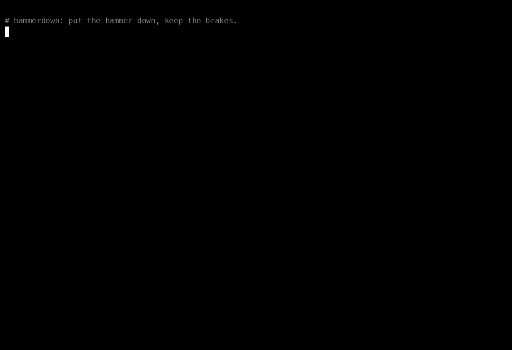

# hammerdown

[](https://github.com/hashjoin/hammerdown/actions/workflows/ci.yml)
[](https://pkg.go.dev/github.com/hashjoin/hammerdown)
[](LICENSE)

**Put the hammer down. Keep the brakes.**



`hammerdown` is a CLI control plane for rolling restarts and upgrades across
large sharded fleets. It is a small, dependency-free Go codebase you fork and
make your own: point it at your inventory, teach it two verbs (restart a
node, fail over a shard), and you get a tool that can walk thousands of
database nodes through an upgrade, shard by shard, with explicit workers,
exact fail-fast, and an ASCII report you can `grep` at 3 a.m.

It ships with a simulated 11,000-node / 2,829-shard fleet, so you can try
every feature on a laptop in under a minute.

```
$ hammerdown roll --workers 64 --dry-run=false --yes --quiet
--------- Plan (dry-run=false) ---------
keyspaces: 20 | shards: 2829 | nodes: 10982 (2829 primaries) | workers: 64
  audit                    64 shard(s)     128 node(s)
  ...
  messages               1088 shard(s)    4345 node(s)
  ...
--------- Roll Result ---------
elapsed:            11.129s
shards completed:   2829 / 2829
primary failures:   0
replica failures:   0
```

## Where it comes from

The pattern is older than most of today's tooling. Oracle E-Business Suite
DBAs know it from `adpatch` and `adadmin`: tell it how many parallel workers
to run, let it hand out the jobs, watch and steer the workers from `adctrl`,
and when something breaks, fix it and run the same command again. It picks up
where it left off.

hammerdown's author has rebuilt that shape for every fleet he has run since:
Oracle Applications first, then InVision (a Kubernetes-based data migrator
that moved customers into private clouds, phase by phase), Auth0 (`fleet`, a
database provisioner behind US patent 11,693,748) and Slack.
The most recent
iteration rolled a ~11,000-node Vitess fleet onto a new version in about 35
minutes, down from more than two days. hammerdown is a clean, generic rewrite
of the pattern, not any employer's code.

| adpatch / adadmin | hammerdown |
|---|---|
| "Number of parallel workers" prompt | `--workers 64` |
| `adctrl` worker status | `report`, and `worker=NN` on every log line |
| `adctrl`: tell workers to quit | Ctrl-C drains: in-flight work finishes, nothing new starts |
| "Continue with your previous session?" | run the same command again to resume |
| `apply=n` test mode | `--dry-run`, on by default |
| defaults file for unattended runs | flags plus `--yes` |

What carried over are the rules that matter when the fleet is big and the
pager is real:

- **The operator drives.** A CLI, not a pipeline: you choose the slice, the
  speed and the stopping point, and you can see everything it will do first.
- **Dry run is the default.** `--dry-run=false` is something you type on purpose.
- **Explicit workers.** `--workers 64` means at most 64 shards in flight,
  fleet-wide. You know the blast radius before you press enter.
- **One shard, one worker, one lock.** Replicas first, then a planned
  failover to a replica already on the new build, then the old primary.
- **Fail fast, exactly.** `--max-primary-failures 1` means the first bad
  failover stops all new work before anything else starts.
- **Stop cleanly.** `--stop-at 90m`, `--blackout 06:00-11:00`, or Ctrl-C:
  in-flight work finishes, locks are released, nothing new starts.
  Run the same command again to resume.

## Quick start

```sh
go install github.com/hashjoin/hammerdown/cmd/hammerdown@latest
# or grab a prebuilt binary (macOS / Linux, amd64 / arm64) from Releases

hammerdown sim init                      # 11,000 simulated nodes on v19.0.4
hammerdown sim stage --to v20.0.1        # "deploy" a build: nodes go RestartWait
hammerdown report                        # where are we?
hammerdown roll --shards-per-keyspace 1   # dry run of a canary: 1 shard per keyspace
hammerdown roll --shards-per-keyspace 1 --dry-run=false --yes
hammerdown roll --workers 64 --dry-run=false --yes
hammerdown report | egrep 'Keyspace:Build|v20' | grep -v 100.00
```

Want to watch fail-fast work? Curse two shards so their failover always fails:

```sh
hammerdown sim init --force && hammerdown sim stage --to v20.0.1
hammerdown roll --workers 64 --sim-cursed 2 --dry-run=false --yes
# ... FAIL-FAST: 1 primary failure(s) reached --max-primary-failures=1, stopping
hammerdown roll --workers 64 --dry-run=false --yes      # resume
```

## Filters

Filters are how you aim. They compose, and `--skip` always wins.

| Flag | Example | Meaning |
|---|---|---|
| `--limit` | `'users/ALL\|teams/-80,80-'` | only these keyspace/shards |
| `--limit` | `'mess*/4*'` | globs on keyspace and shard |
| `--skip` | `'billing/ALL'` | never these |
| `--primary-only` / `--replica-only` | | by role |
| `--cell` | `az1,az2` | by AZ / cell |
| `--host` | `'db-teams-00*'` | by host glob |
| `--target` | `v20.0.1` | only nodes staged for this build |
| `--force-ok` | | include nodes already OK (forced restart) |
| `--shards-per-keyspace` | `1` | canary: first N shards of every keyspace |

`report` takes the same `--limit/--skip/--cell/--host` to scope what it shows,
and `--json` for scripts (and for Claude).

## Speed and safety knobs

| Flag | Default | |
|---|---|---|
| `--workers` | 8 | max shards in flight across the fleet |
| `--keyspace-workers` | 0 | max shards in flight per keyspace (0 = no cap) |
| `--dry-run` | true | log everything, touch nothing, take no locks |
| `--max-primary-failures` | 1 | drain after N failover-side failures |
| `--max-replica-failures` | 5 | drain after N restart failures |
| `--stop-at` | | `90m` or RFC3339: no new shards after this |
| `--blackout` / `--blackout-tz` | | `06:00-11:00` `America/Los_Angeles`: no new shards inside |
| `--jitter` | backend | random splay before every restart |
| `--yes` | false | skip the "type hammerdown to continue" prompt |

Ctrl-C once drains (in-flight operations finish, nothing new starts). Twice
aborts in-flight operations. Three times exits immediately.

## Make it yours

hammerdown is a template as much as a tool. The engine never talks to your
infrastructure directly; a **backend** does, and backends are wired in one
place, `cmd/hammerdown/backends.go`:

```go
func backends() []backend.Factory {
	return []backend.Factory{
		sim.NewFactory(),
		shell.NewFactory(),
		vitess.NewFactory(), // <- yours
	}
}
```

A backend provides an `Inventory` (what's out there), a `Processor` (how to
roll one shard), a `Locker` (locks your other automation respects) and
optional `Guards` (per-shard pre-flight checks). For any primary/replica
system the bundled `roll.LeaderAware` processor already does the hard part;
you implement two methods:

```go
type NodeOps interface {
	Restart(ctx context.Context, n *fleet.Node) error                     // block until healthy
	Failover(ctx context.Context, s *roll.Shard, from, to *fleet.Node) error // block until demoted
}
```

No Go yet? The **shell backend** drives your existing scripts:

```sh
hammerdown roll --backend shell \
  --shell-inventory ./inventory.sh \
  --shell-restart  'ssh {{.Node.Host}} sudo systemctl restart mysqld' \
  --shell-failover './failover.sh' --workers 4
```

See [`examples/shell`](examples/shell) and [`docs/extending.md`](docs/extending.md).

## Built to be extended with Claude

The repo ships with a [`CLAUDE.md`](CLAUDE.md) that explains the architecture,
the invariants that must never break, and the exact recipe for adding a
backend, plus a project skill in `.claude/skills/add-backend`. Open the repo
in Claude Code and ask:

> Add a backend for our Postgres fleet managed by Patroni. Inventory comes
> from `patronictl list -f json`, failover is `patronictl switchover`.

It knows where the seams are, what to test, and what not to touch.

## The CB toolbox

hammerdown is the first of a family of small, single-purpose ops CLIs under
the same roof, named in the spirit of the 70s CB radio it borrows from:

| Name | Job | Status |
|---|---|---|
| `hammerdown` | fleet-wide rolling restarts and upgrades | here |
| `rubberduck` | the lead truck: canary rollouts that gate the convoy | planned |
| `smokey` | the watchdog: SLO-aware stop conditions | planned |
| `breaker` | the kill switch: shared drain signal for every running roll | planned |
| `tenfour` | acknowledgements: two-person approval for risky runs | planned |

## Project layout

```
cmd/hammerdown/   CLI; backends.go is the injection point
fleet/            Node model + Inventory interface
filter/           keyspace/shard Spec parser + node predicates
roll/             scheduler (Batch), LeaderAware processor, NodeOps, Window
lock/             Locker interface + Memory and Dir implementations
report/           ASCII and JSON reports
backend/          Backend + Factory interfaces
backend/sim/      11,000-node simulated fleet (default)
backend/shell/    drive your own scripts
```

Zero dependencies outside the Go standard library. `go test -race ./...`.

## Contributing

Issues and PRs welcome: new backends, filters, guards and war stories alike.
See [CONTRIBUTING.md](CONTRIBUTING.md).

## License

Apache 2.0. Maintained by [HASHJOIN](https://hashjoin.com): operations
automation you can trust at 3 a.m.
